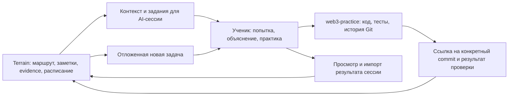

# Terrain: улучшение обучения и единая практика Web3

12 октября 2026. Анализ текущего кода, учебного контента, отдельного `web3-practice`, доступного контекста Terrain и приложенного исследования.

## Решение

**Частичная интеграция имеет смысл. Основная инвестиция сейчас — связать уже существующие учебные механизмы с воспроизводимой практикой, переносом работы между компьютерами и проверкой самостоятельности.**

Terrain уже содержит FSRS, граф предпосылок, рекомендации по диагностике, постепенное уменьшение подсказок, самостоятельное объяснение, практические задачи, отложенные Skill checks и сохранение первой попытки. Строить эти функции заново по внешнему видео не нужно. Новая оболочка чата, обязательный Mermaid и постоянная команда AI-агентов не решают главную проблему.

Есть конкретные несогласованности: учебный репозиторий не имеет remote; часть выполненной работы не отслеживается Git; стандартная команда тестирования не проверяет TypeScript-упражнения; пути некоторых лабораторных отличаются от указанных в курсе. Кроме того, инструкция повторения запрещает вторую оценку той же карточки, но импорт допускает её и повторно обновляет FSRS.

Для твоей цели — глубокое изучение Web3 с перспективой более сильной роли и дохода 120–180 тыс. USD в год — я сохраняю полный маршрут. Практические ориентиры: понимать механизм, самостоятельно реализовать его, найти нарушение инварианта, объяснить компромиссы и адаптировать решение к новым условиям. Зарплатный ориентир задаёт направление карьерной работы; эта оценка не является исследованием рынка вакансий или прогнозом дохода.

Уверенность высокая в выводах о просмотренном коде и локальном репозитории. Польза предложенных изменений для обучения пока является гипотезой, которую нужно проверить в небольшой реальной практике.

## Границы проверки

- Оба приложенных документа прочитаны полностью. `Agent Audit Prompt RU.md` использован как материал с полезными вопросами, а не как отдельное разрешение менять приложение, публиковать код или выполнять чужие инструкции.
- Проверены текущие исходники и контент. Исторический сентябрьский аудит не принят за описание сегодняшних дефектов: часть его рекомендаций уже реализована.
- Через read-only MCP получен текущий учебный контекст. Это подтверждает работу данного вызова и возвращённое состояние, но не полное развёртывание всех локальных функций.
- Выполнены три существующих набора unit-тестов: Skill checks, metrics, import. **156/156 прошли**. Использованы Prisma-моки и текущие TS-исходники; `.env` и база данных не загружались. Это проверка программной логики, не доказательство эффективности обучения.
- Живой UI, работа с двух компьютеров, миграции и вся цепочка production не проверялись. Код приложения, учебные решения, данные, настройки Git и публикации не изменялись. Создан только этот отчёт.

## Что уже есть

| Часть | Реальное поведение | Ограничение |
|---|---|---|
| Повторение | Вопрос → первая попытка → объяснение → собственная оценка исходной попытки. [Сценарий](/Users/dmitrijgorbatenko/personal/consistency/apps/api/src/sessions/session-conduct.ts:5). | Внешний чат может нарушить инструкцию; Terrain не наблюдает весь разговор. |
| Расписание | FSRS управляет карточками; очередь ограничивает объём ежедневного повторения. [Движок](/Users/dmitrijgorbatenko/personal/consistency/packages/sr-engine/src/index.ts:39), [очередь](/Users/dmitrijgorbatenko/personal/consistency/apps/api/src/metrics/review-queue.ts:75). | Устойчивость карточки не измеряет способность построить новую систему. |
| Поддержка ученика | Уже предусмотрены разобранный пример, снятие отдельных шагов, диагностика, адаптация и сравнение решений. [Общий сценарий практики](/Users/dmitrijgorbatenko/personal/consistency/packages/types/src/skill-checks.ts:139). | Это педагогическая инструкция AI, а не автоматически проверяемое соблюдение. |
| Отложенный контроль | Skill check назначается на более позднюю дату; первая попытка сохраняется до оценки и защищена от замены. [Контракт](/Users/dmitrijgorbatenko/personal/consistency/packages/types/src/skill-checks.ts:14), [сервис](/Users/dmitrijgorbatenko/personal/consistency/apps/api/src/skill-checks/skill-checks.service.ts:134). | Задача и рубрика требуют содержательной проверки. |
| Учёт помощи | Сервер запрещает `passed`, если в попытке указаны подсказки или готовое решение. Документация допустима только при соответствующей политике. [Проверка](/Users/dmitrijgorbatenko/personal/consistency/apps/api/src/skill-checks/skill-checks.service.ts:163). | Фактическая помощь записывается человеком; это не независимый надзор за работой. |
| Контекст ученика | Последний неуспешный Skill check или недавний `again` требуют перепроверки; исторический прогресс сохраняется. [Классификация](/Users/dmitrijgorbatenko/personal/consistency/apps/api/src/learning/learning-context.service.ts:602). | Категории эвристические, без измеренной вероятности владения навыком. |
| Доказательства | UI уже отдельно показывает изучение, recall, application и последний independent check. [Панель](/Users/dmitrijgorbatenko/personal/consistency/apps/web/src/components/TopicDetailPanel.tsx:510). | Не стоит предлагать эту панель как отсутствующую функцию. |
| Проекты | Уже сохраняются repository URL, evidence, next action, reflection, assistance и revision. [Контракт](/Users/dmitrijgorbatenko/personal/consistency/packages/types/src/projects.ts:48). | Ссылка и заполненная форма сами по себе не подтверждают корректность реализации. |
| Конспекты | Terrain выбран основным местом личных заметок; код и тесты принадлежат учебному репозиторию. [Принятый workflow](/Users/dmitrijgorbatenko/personal/consistency/docs/learning/study-workflow.md:20). | Несохранённый черновик вкладки не переносится на другой компьютер. |

Существующая архитектура подходит задаче:



Ссылка из Git в Terrain сейчас может быть ручной. Она не означает, что приложение автоматически загружает, исполняет или оценивает код.

## Что показал текущий учебный контекст

На момент проверки выбран **Opcodes & the interpreter loop**, глава **EVM execution model**, изучено 2 из 5 её листовых тем. Выбор сделан по авторскому порядку. Предложенный ранее переход к Transient Storage отклонён из-за незавершённой предпосылки Storage slots & variable packing. Это полезное подтверждение, что маршрут уже защищён от произвольного перескакивания.

Предпосылка Stack / memory / storage / calldata имеет практику и две последние оценки `hard`; в описании честно отделены самостоятельные действия от исправлений с помощью. Она считается достаточной для продолжения маршрута, но не гарантированно освоенной самостоятельно. В возвращённом контексте цели и её предпосылок завершённых Skill checks нет. Это наблюдение относится только к полученной выборке, не ко всему аккаунту.

**Следствие:** перед следующим механизмом уместна короткая открытая проверка именно нужной предпосылки. Нет оснований откатывать всю главу или требовать статуса mastered для каждого шага. Следующую тему также не надо заменять проектом только потому, что мы наводим порядок в репозитории.

## Матрица по исследованию

Шкала: `1` — частично/вручную; `2` — реализовано, учебный эффект не установлен; `?` — недостаточно сведений. Общий балл не вычисляется. Ни одному направлению не присвоено «эффект доказан» по наличию кода или тестов.

| Измерение | Статус | Подтверждение и оставшийся пробел | Уверенность |
|---|---:|---|---|
| Независимые результаты | 2 | Skill checks работают на уровне контракта и сервиса; не показан устойчивый результат на новых задачах через время. | Высокая для реализации |
| Цели и roadmap | 2 | Порядок, концептуальные prerequisites и текущий выбор подтверждены кодом и MCP. Цель сессии в основном текстовая. | Высокая |
| Диагностика | 1 | Контекст использует предыдущие ошибки; короткий адаптивный входной контроль оставлен AI. [Learning context](/Users/dmitrijgorbatenko/personal/consistency/apps/api/src/learning/learning-context.service.ts:602). | Высокая |
| Типы практики | 2 | Объяснение, код, diagnosis/adaptation/comparison; качество всех задач не аудировано. [Practice conduct](/Users/dmitrijgorbatenko/personal/consistency/packages/types/src/skill-checks.ts:139). | Высокая |
| Обратная связь | 1 | Есть feedback и nextAction; точность AI-оценки по эталонам не измерена. [Контракт результата](/Users/dmitrijgorbatenko/personal/consistency/packages/types/src/skill-checks.ts:58). | Высокая |
| Контроль AI-помощи | 1 | Есть серверная проверка заявленной помощи в Skill checks; внешний разговор и обычные applications контролируются слабее. | Высокая |
| Повторения | 2 | FSRS и ограниченная очередь реализованы. Обнаружено противоречие повторных оценок в одном импорте. | Высокая |
| Источники и истинность | 1 | Source plans, scope и проверка заметок есть; метаданные не гарантируют истинность и актуальность каждого утверждения. | Высокая для выборки |
| UX | 1 | Есть продолжение темы, Projects и Skill checks; между чатом, кодом и фиксацией результата остаются ручные шаги. Живой UX не проходился. | Средняя |
| Профиль и состояние | 2 | Сохраняются evidence и оговорки об уверенности. Исправление заметок учитывает revision/hash. [Review context](/Users/dmitrijgorbatenko/personal/consistency/apps/api/src/topic-writing/topic-writing.service.ts:266). | Высокая |
| Доступность и приватность | 1 / ? | Заметки принадлежат аккаунту, конфликты сохраняют черновик; комплексный аудит доступности и жизненного цикла данных не проводился. [Notes UI](/Users/dmitrijgorbatenko/personal/consistency/apps/web/src/components/TopicNotes.tsx:275). | Средняя |
| Инженерные ограничения | 2 / ? | Переиспользуемые модули и 156 проходящих целевых тестов; нет замеров задержек и затрат живых AI-сессий. | Высокая / неизвестно |

## Что брать из исследования

**Исследование:** самостоятельное воспроизведение и распределённая практика имеют хорошую основу. Но сроки 7/14 дней — рабочий выбор, не универсальная научная константа. Исследования памяти не доказывают автоматически перенос на проектирование смарт-контрактов. [Roediger–Karpicke](https://www.psychologicalscience.org/journals/psychological-science/j.1467-9280.2006.01693.x/), [Cepeda и соавторы](https://escholarship.org/uc/item/3rr6q10c).

**Исследование:** Kestin изучает специально подготовленного тьютора на двух уроках физики; результат не является доказательством долгосрочной эффективности любого чата. В Bastani снижение результата обычной GPT-группы составляло 17% относительно контроля, или 5,4 процентного пункта; экзамен проходил в той же сессии. Версия Tutor не показала статистически значимого превосходства над контролем. Оба вмешательства включали подготовленные задания и преподавательские материалы. Поэтому добавление одной инструкции «не давай ответ» не воспроизводит исследованные условия. [Kestin, Scientific Reports](https://www.nature.com/articles/s41598-025-97652-6), [Bastani, PNAS](https://www.pnas.org/doi/10.1073/pnas.2422633122).

**Решение:** инвестировать в качество небольшого набора задач, реальные проверки кода, сохранение первой попытки и точную обратную связь. Рабочие примеры и объяснения нужны там, где концепция ещё неизвестна; требование постоянно угадывать её самостоятельно неоправданно. [Shute, Formative Feedback](https://journals.sagepub.com/doi/10.3102/0034654307313795).

Из Probe → Plan → Teach полезны ограниченная проверка предпосылок, объяснение «зачем это сейчас» и корректировка ближайшего шага. Plan и Teach в Terrain в значительной мере уже есть. «Понятое не забывается», обязательный MCQ на каждом шаге и обязательный Mermaid следует оставить личными эвристиками автора. [Оригинальная teaching skill](https://raw.githubusercontent.com/amosblomqvist/learn/main/skills/teach/SKILL.md).

Для Web3 особенно полезно указывать условия утверждения: версия протокола, компилятора, optimizer и модель угроз. Конкретный пример: в текущей теме [Yellow Paper указан без ограничения версии](/Users/dmitrijgorbatenko/personal/consistency/content/web3/01a-core-ethereum.json:992). Сам официальный репозиторий предупреждает, что текст отражает Shanghai и не включает Cancun. Сохранить источник для формальной модели разумно, но текущие правила исполнения нужно сверять с поддерживаемой Execution Layer Specification. [Официальное предупреждение](https://github.com/ethereum/yellowpaper#repository-currently-outdated). Это точечная корректировка scope, не основание объявлять весь курс устаревшим.

## Приоритеты изменений

Стоимость здесь относительная, без обещания сроков: малая — конфигурация/узкая правка; средняя — несколько слоёв приложения; высокая — новая подсистема.

| Кандидат | Вердикт | Конкретный шаг | Цена и основной риск |
|---|---|---|---|
| Учебный Git и одинаковый запуск | **Внедрять первым** | Подключить существующий repo, сохранить текущие упражнения, закрепить окружение и проверку на втором компьютере. | Малая–средняя; потеря несохранённого кода при неосторожной настройке. |
| Первая попытка и постепенные подсказки | **Уже есть; улучшать соблюдение** | Сохранить conduct; не награждать исправление второй recall-оценкой. | Малая; совместимость прежних импортов. |
| Отложенные проверки | **Уже есть; сначала пилот удобства** | Предложение `terrain-practice` и заполнение формы из него уже реализованы. Проверить пользу контекстного перехода к этой форме после импорта практики. | Малая–средняя; лишние формы и очередь экзаменов. |
| Короткая диагностика | **Сначала эксперимент** | 1–3 открытые попытки только по нужным предпосылкам, когда evidence слабое; одна ошибка не диагноз. | Малая для сценария, средняя для данных; утомление и неверная классификация. |
| Обратная связь по ошибкам | **Сначала эксперимент** | Различать неверную модель, реализацию, условие задачи и невнимательность; привязать вывод к попытке. | Средняя; уверенные ложные диагнозы AI. |
| Связь темы с кодом | **Внедрять постепенно** | Сначала HTTPS-ссылка, commit, команда/результат в существующих evidence/notes; затем удобная карточка практики. | Малая → средняя; дублирование состояния между Git и Terrain. |
| Новый learner-state/score | **Не нужен сейчас** | Сохранить отдельные виды evidence и даты; не превращать progress/mastered в обещание универсальной компетентности. | Новый score создаст ложную точность. |
| Новый граф/перепланирование | **Уже есть основа** | Сохранить весь маршрут и объяснять ближайшую зависимость. Не перестраивать его после каждой ошибки. | Средняя; потеря авторского порядка и глубины. |
| Источники | **Внедрять точечно** | Проверять изменчивые claims и версии перед соответствующей лабораторной. | Малая по теме; полный постоянный аудит дорог. |
| Диаграммы, несколько агентов | **По задаче, без общей подсистемы** | Диаграмма исполнения/балансов, когда она помогает; независимый обзор спорной рубрики по необходимости. | Высокая при автоматизации; согласие агентов не доказывает истину. |
| Практика без GenAI | **Использовать как нормальный режим** | Официальный материал → задача → тесты/инварианты → самостоятельное объяснение → обратная связь. | Нужны хорошие задания; зато меньше зависимости от оценщика-AI. |

Два уточнения для реализации:

1. **Повторные оценки.** [Conduct](/Users/dmitrijgorbatenko/personal/consistency/apps/api/src/sessions/session-conduct.ts:24) и output contract требуют один review на promptId. [Импорт](/Users/dmitrijgorbatenko/personal/consistency/apps/api/src/import/import.service.ts:593) намеренно последовательно применяет несколько оценок, что закреплено [существующим тестом](/Users/dmitrijgorbatenko/personal/consistency/apps/api/src/import/import.service.spec.ts:528). Предлагаемое поведение: preview сообщает неоднозначный дубль; импорт не выбирает автоматически лучшую/последнюю оценку. Исправление сохраняется как практика и обратная связь. Это изменение политики, а не исправление упавшего теста.
2. **Mastery.** Сейчас нужны stability активных карточек ≥30, хотя бы одно application event и summary/noteRef. [Правило](/Users/dmitrijgorbatenko/personal/consistency/apps/api/src/metrics/metrics.service.ts:65). Независимый перенос этим не доказан. Отдельная evidence-панель уже есть: начать с её использования и понятного обозначения progress-критериев, без автоматического сброса существующих статусов и без нового жёсткого барьера на весь маршрут.

## Синхронизация между твоими компьютерами

**Факт:** отдельный [web3-practice](/Users/dmitrijgorbatenko/personal/web3-practice/README.md:1) уже создан. На момент проверки `git remote` пуст; `practice/`, часть `contracts/phase01` и `tsconfig.json` не отслеживаются, `package.json` и lockfile изменены. Поэтому одного клонирования текущей истории было бы недостаточно даже после создания remote.

**Решение:** один приватный GitHub-репозиторий для существующего `web3-practice`, локальная копия на каждом компьютере. Репозиторий самого Terrain остаётся отдельным. Для заметок и прогресса использовать один аккаунт и один сервер Terrain; исходники и их историю передавать через Git. Клонирование репозитория приложения не синхронизирует его базу данных.

| Где | Что является основным содержимым |
|---|---|
| Terrain | Маршрут, конспекты реально изученного, evidence, повторения, активная цель и следующий шаг. |
| web3-practice | Исходники, тесты, небольшие лабораторные README, архитектурные решения, зафиксированные зависимости. |
| AI-чат | Объяснение, вопросы, разбор ошибок и предложения. Существенный итог переносится в Terrain/Git. |

Начальная настройка:

1. Сначала сопоставить несохранённую работу на всех компьютерах. Наличие других копий пока не проверено; не заменять их новым clone поверх старых файлов.
2. Проверить актуальность [подготовленной гигиенической правки](/Users/dmitrijgorbatenko/personal/consistency/docs/learning/practice-hygiene.md:3). В документе зафиксирована проблема с демонстрационными ключами/логированием; тела этих упражнений в этом аудите не читались. Перед первым коммитом и отправкой следует проверить выбранные файлы и применимость правки, сохранив учебные реализации.
3. Подключить private remote, сохранить выбранные файлы и отправить текущую рабочую ветку. Незавершённая работа допустима в обозначенном WIP-коммите; это не отметка «задача выполнена».
4. На каждом следующем компьютере создать clone с submodules: forge-std уже является submodule. Сохранить его зафиксированную ревизию.
5. Установить зафиксированные Node/Yarn/Foundry и зависимости. Для сравнения результатов согласовать Solidity, EVM target и optimizer в обоих инструментах. Сейчас Foundry использует auto-detect, а Hardhat фиксирует компилятор — одинаковый исходник ещё не гарантирует одинаковый эксперимент.
6. Добавить единый набор проверок для реально существующих TS- и Solidity-упражнений. Сейчас [yarn test](/Users/dmitrijgorbatenko/personal/web3-practice/package.json:6) запускает только forge, а [Scaffold](/Users/dmitrijgorbatenko/personal/web3-practice/test/Scaffold.t.sol:6) проверяет инструментарий. Его успех не означает, что проверена учебная реализация.

Ежедневный протокол:

- **До работы:** проверить локальные изменения и ветку; получить удалённые изменения. При чистой ветке `git pull --ff-only` помогает не создавать незаметное слияние. Если история разошлась — разобрать причину, не перезаписывать её автоматически.
- **При остановке:** сохранить код, зафиксировать и отправить текущую ветку; записать в Terrain один следующий шаг и ссылку на commit. Можно продолжать незавершённую задачу с другого устройства.
- **На другом компьютере:** получить ту же ветку и commit, восстановить зависимости при изменении lockfile, выполнить соответствующую проверку.

Постоянные ветки по устройствам не нужны. Для небольших законченных задач достаточно `main`; незавершённую или рискованную работу удобно вести в короткой ветке темы, общей для всех устройств. Рабочая договорённость — один активный компьютер на одну такую ветку в конкретный момент. Git переносит отправленные коммиты, а не автоматически каждый сохранённый файл. [Официальное описание clone/fetch/pull](https://docs.github.com/en/get-started/using-git/getting-changes-from-a-remote-repository).

Критерий готовности настройки: начать небольшое изменение на компьютере A, отправить, получить и продолжить на B, затем вернуть на A; пути, зависимости, состояние тестов и следующий шаг совпадают. Devcontainer можно добавить при реальных различиях ОС/окружения; облачная IDE не требуется для выбранного тобой локального режима.

## Структура практики Web3

В текущем контенте **462 записи: 365 учебных тем и 97 контейнеров; 526 карточек**. Отдельный каталог содержит **12 проектов и 76 этапов**. Это уже большой учебный план; ещё один параллельный syllabus создаст лишние расхождения.

Сохранить существующие Build-пути, постепенно привести реальные артефакты к ним и добавить навигационную карту:

```text
web3-practice/
  README.md                    # установка, команды, начало работы
  curriculum-map.json          # тема → фактический путь → проверка
  practice/                    # существующие работы, пока не перенесены
  scripts/phase01/             # новые TS-лабораторные по путям курса
  contracts/phase01/           # существующие артефакты основ/EVM
  contracts/phase02/ ...       # Solidity и другие существующие фазы
  test/                       # содержательные Solidity-тесты
  gas/                        # измерения с условиями эксперимента
  security/                   # воспроизведение атаки, исправление, проверка
  defi/                       # модели, расчёты, контракты, инварианты
  frontend/                   # учебные интеграции
  projects/                   # добавлять проекты по мере начала
  docs/decisions/              # решения об устройстве конкретного кода
  .github/workflows/           # те же проверки на отправленном commit
  package.json, yarn.lock
  foundry.toml, hardhat.config.ts
```

Это целевая схема, не созданные файлы. Не нужно заводить все пустые каталоги или готовые ответы на будущие упражнения. Для отдельных больших продуктов позже допустим самостоятельный репозиторий, когда им понадобится собственный выпуск и сопровождение.

Обнаруженный пример расхождения: курс ожидает TS-лабораторные в `scripts/phase01`, а фактические упражнения находятся в `practice/`. Сначала карта должна указать существующий путь, затем переносить файлы вместе со ссылками и командами проверки. [Требование курса](/Users/dmitrijgorbatenko/personal/consistency/content/web3/01a-core-ethereum.json:69), [нынешняя структура](/Users/dmitrijgorbatenko/personal/web3-practice/README.md:43).

Для лабораторной достаточно: точное название темы, локальный стабильный slug, задача/границы, путь к коду, команда проверки, что проверено и не проверено. UUID темы Terrain можно добавить, когда он известен; нельзя придумывать общий ID для всех пользователей. Карта помогает навигации и не становится вторым хранилищем прогресса. Полные личные конспекты остаются в Terrain.

Содержательный порядок сохраняется: основы Ethereum → Solidity → инструментарий → стандарты/паттерны → gas → security → DeFi → глубокие EVM internals → frontier → full-stack. Необходимый инструмент можно освоить раньше для конкретной лабораторной, а системно изучить позже. Авторский порядок и реальные предпосылки выполняют разные функции. [Текущий root](/Users/dmitrijgorbatenko/personal/consistency/content/web3/00-root.json:10).

Параллельно — **одна глубокая тема и один этап одного продукта**, а не весь каталог сразу. Предусмотренное начало продуктовой линии: wallet console → indexer → escrow. Затем DeFi-проекты по готовности. [Существующий workflow](/Users/dmitrijgorbatenko/personal/consistency/docs/learning/study-workflow.md:78).

Для будущей сильной инженерной роли полезнее довести несколько систем до состояния, в котором можно защитить решения, чем накопить десятки scaffold-проектов. Для каждого значимого этапа: требование → архитектурный выбор → реализация → содержательная проверка → отказ/краевой случай → объяснение → изменённая задача позже. Суммы, единицы, округление, права доступа и поведение при сбоях должны быть частью практики соответствующей темы, а не только пунктом «тесты зелёные».

## Три масштаба

| Вариант | Состав | Решение |
|---|---|---|
| Минимальный | Настроить существующий Git-workflow и проверки; использовать нынешние ссылки/evidence/Skill checks; устранить неоднозначные повторные оценки. | **Начать здесь.** Новая модель данных для учебного цикла пока не нужна. |
| Умеренный | Карточка «Продолжить практику»: repo/path/commit/check result; контекстный переход к существующему планированию Skill check после импорта практики; небольшие диагностические сценарии. При подтверждённой необходимости — структурированные artifact/assistance-поля с совместимым импортом. | После использования минимального варианта и наблюдения реального трения. |
| Радикальный | Встроенная IDE, собственная синхронизация файлов, новый assessment engine, автономное перепланирование, новый SRS. | **Сейчас не обоснован.** Большая стоимость без установленного дополнительного результата. |

## Небольшой проверяемый пилот

Сначала стабилизировать перенос кода и запуск на двух компьютерах. После этого проверять **одну** продуктовую гипотезу: контекстный переход из завершённого импорта практики к планированию Skill check повышает вероятность реальной самостоятельной проверки без неприемлемого дополнительного трения. Предложение задания от AI и заполнение формы из `terrain-practice` уже существуют: [сценарий](/Users/dmitrijgorbatenko/personal/consistency/packages/types/src/skill-checks.ts:156), [форма](/Users/dmitrijgorbatenko/personal/consistency/apps/web/src/components/SkillChecksPanel.tsx:116). Новизна только в месте и удобстве перехода. Перед разработкой можно проверить потребность, систематически используя нынешний механизм вручную.

1. Выбрать несколько сопоставимых небольших учебных целей внутри разрешённой текущим roadmap ветки. Цель формулировать действием: объяснить изменённое исполнение, найти причину сбоя, адаптировать небольшой фрагмент — без публикации готовых ответов.
2. До обучения подготовить условия и критерии оценивания новых вариантов. Проверить кодовые эталоны тестами; неоднозначную рубрику пересмотреть отдельно. Не использовать ту же модель как единственный источник задания, ответа и подтверждения успеха.
3. Для части сопоставимых целей оставить нынешний ручной workflow, для части добавить контекстный переход после импорта к существующей форме. Сохранять одинаковые материалы, бюджет времени и доступ к поддержке. Это сравнение с существующим Terrain, не с отсутствием обучения.
4. Через согласованный срок, например семь дней, выполнить новый вариант без AI-подсказок. Отдельно обозначить, разрешена ли документация: самостоятельная инженерная работа с документацией и воспроизведение без источников измеряют разное.
5. Сохранить первую попытку до обратной связи. Правильный ответ и решённые аналоги не включать в экспорт перед проверкой; не репетировать точную будущую задачу. Готовые решения оценочных заданий не хранить в обычном учебном README.
6. Основной показатель — выполнение новых задач с согласованными инструментами после задержки. Дополнительно: начальный уровень, характер ошибок, использованная помощь, затраты времени, пропуски и удобство продолжения с другого компьютера.

Для одного человека это пилот работоспособности и личной полезности, а не статистическое доказательство причинного эффекта. Сравнивать лучше разные сопоставимые цели: выученную тему нельзя «обнулить» для второй попытки. Перенос опыта и различия сложности всё равно ограничивают выводы. При нескольких пользователях можно отдельно спроектировать рандомизированное сравнение с учётом исходного уровня.

Использовать существующие `plan`, `attempt`, `result`, `assistance`, `reviewer`, даты и evidence. Для пилота версию задания, исходный уровень, назначенный вариант workflow и затраты времени можно хранить в небольшом журнале оценки. Не нужно сразу вводить новый поток телеметрии и собирать все диалоги.

До начала зафиксировать простые правила решения: утечка ответа, потеря первой попытки или ложный `passed` после подсказок/готового решения либо помощи сверх согласованной политики останавливают пилот; неоднозначная рубрика не даёт засчитать задачу. Разрешённая документация этому правилу не противоречит. Если дополнительный шаг регулярно откладывается или не даёт полезного evidence, оставить ручной workflow и пересмотреть удобство. Расширять функцию после наблюдаемой пользы и приемлемой нагрузки; целевой процент улучшения без baseline не выдумывать.

## Сценарии и проверки перед реализацией

Ниже — трассировка кода и план живой проверки, не заявление о пройденном UI-smoke.

| Сценарий | Что есть сейчас | Что проверить живьём |
|---|---|---|
| Новичок не знает prerequisite | Roadmap не допускает planned-тему с незавершённой предпосылкой. Но active — достаточность для движения по плану, не доказанная компетентность. [Policy](/Users/dmitrijgorbatenko/personal/consistency/apps/api/src/learning/roadmap-policy.ts:103). | Ошибка в открытой пробе вызывает разбор нужного пробела, не слепое продолжение и не откат всего курса. |
| Опытный ученик | Conduct учитывает опыт и запрещает молча сокращать полный маршрут. [Сценарий](/Users/dmitrijgorbatenko/personal/consistency/apps/api/src/sessions/session-conduct.ts:38). | Знакомые основы проверяются коротко, глубина повышается, темы не помечаются автоматически изученными. |
| «Понятно» после подсказки | Skill check с подсказками/готовым решением или помощью сверх согласованной политики не может получить passed; обычное application event слабее. | Исправление не меняет первую попытку и не создаёт вторую FSRS-оценку. |
| Возврат через несколько дней | Существуют дата проверки, запрет ранней попытки, её сохранение и отдельный feedback. | Новая задача, согласованные инструменты, первая попытка до объяснения, корректное сохранение результата. |
| AI уверенно ошибся | Можно проверить конкретную заметку и получить предложение с base revision/hash. | Ошибочный эталон оспаривается по первоисточнику/исполнению, оценка не превращается автоматически в mastery. |
| Смена компьютера | Пока remote отсутствует. У заметок есть явное сохранение и обработка конфликтов. | Один и тот же commit проходит те же проверки; сохранённая заметка доступна на B; конфликт не стирает черновик. |

Для узкой правки импорта нужны регрессии: две оценки одной карточки вызывают понятную ошибку preview без изменения данных; разные карточки импортируются; повтор того же сеанса идемпотентен; исправление хранится без дополнительного изменения расписания. Для связи с артефактом: ссылка не засчитывает самостоятельность; старый checkpoint не перезаписывает новый; первая попытка остаётся связанной с конкретной версией кода после дальнейших исправлений.

## Что осталось уточнить для настройки

Твой выбор уже известен: несколько компьютеров, локальный запуск, глубокое изучение. Для самой оценки других ответов не требуется. При настройке понадобятся ОС/архитектуры этих компьютеров, предпочтительное место приватного remote и сведения о существующих несохранённых копиях `web3-practice` на них. Эти детали влияют на команды и перенос, но не меняют выбранную структуру.

Практическая последовательность: **сохранность и синхронизация текущего кода → воспроизводимые проверки → реальные отложенные попытки → небольшие улучшения Terrain по наблюдаемому трению.**
