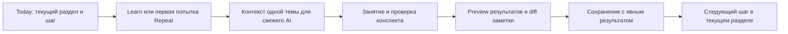

# Terrain: заметки и понятный учебный цикл

Статус: пользователь одобрил реализацию; код подготовлен локально, выпуск на сервер ещё не выполнен.
Дата: 2026-10-03. Связанный [план реализации](../plans/2026-10-03-notes-review-and-learning-ux.md).

## Проблема и ожидаемый результат

Terrain уже поддерживает Today, Learn/Repeat, preview импорта, FSRS, независимые
проверки, source evidence, редактор заметок с revision/conflict handling и граф
с drill-down. Проблема сейчас в связях между этими возможностями и в значении
отображаемых данных. Массовые AI-заготовки в `Your notes` выглядели как личные
конспекты; `started` можно прочитать как `completed`; завершение импорта говорит
`Saved`, хотя полный конспект ещё нужно переносить вручную.

Нужен цикл, в котором понятно: где я сейчас, что сохранилось после занятия,
какой текст написал или проверил AI, что я действительно сделал самостоятельно
и какой следующий небольшой шаг относится к текущему разделу.

Текущая глава и следующий урок берутся из реального roadmap. Счётчики начатых
тем не доказывают независимого владения. Полный curriculum сохраняется;
практические проекты появляются на соответствующих этапах курса.

## Глобальные ограничения

1. Не менять статусы тем, prerequisites, порядок курса, FSRS, оценки и свидетельства
   вследствие проверки или редактирования текста. Корректность конспекта не равна mastery.
2. Не помещать будущие уроки и главы в личные заметки массовым добавлением.
   AI-справки хранить отдельно с происхождением и состоянием проверки версии.
3. Проверять одну тему в свежем контексте. Чтение полной актуальной заметки обязательно;
   спорные/меняющиеся утверждения сверять с первичными источниками.
4. Сохранять объяснения и фактическую историю ученика; не придумывать прочитанные
   источники, выполненные упражнения, самостоятельность или успешные проверки.
5. Все чтения/записи ограничивать JWT userId; применять revision и hash при AI-правках.
   Конфликт не должен затирать другую версию или терять черновик.
6. Во время recall открывать ответосодержащие заметки после первой попытки.
   Payload ожидающей независимой проверки не передавать в notes-review context.
7. Сохранить совместимость строгого `learning-os` v2 и текущего ручного редактора.
   MCP остаётся read-only; запись выполняется через авторизованный интерфейс приложения.
8. Следовать Yarn/Prisma 7/oxlint/oxfmt и no-commit правилам проекта; секретные файлы
   не читать. Реализацию, schema deployment и импорт reference library выполнять отдельно
   после рассмотрения этого плана.

## Предлагаемый пользовательский путь



В первой версии AI остаётся во внешнем диалоге, используется текущий clipboard
workflow. Кнопка готовит компактный контекст и просит начать новый диалог;
она не обещает, что приложение само запустило новый AI или гарантировало его
независимость. Проверка может закончиться без изменений. Глобальной отметки
«все заметки проверены» нет.

## Приоритеты UX

| Приоритет | Изменение | Проверяемый результат |
| --- | --- | --- |
| P0 | `Your notes` и `AI reference` отдельно | Справка будущего урока не попадает в recent notes и не выглядит как обучение |
| P0 | Review одной темы с diff и происхождением | Понятны причина правки, источники, исходная версия и что реально сохранено |
| P1 | Завершение сессии без ручного второго переноса | Один preview принимает результаты занятия и отдельное предложение для заметки |
| P1 | Roadmap с ясными счётчиками | Started, recorded practice и independent check passed имеют разные подписи |
| P1 | Today привязан к текущему разделу | После занятия виден небольшой следующий шаг, полный курс доступен отдельно |
| P2 | Читаемость, мобильная работа, доступность | Заметки, код, ссылки, diff и конфликт удобно читать и сохранять с клавиатуры/телефона |

Существующие Review/Learn tracks, source plans, Evidence, проекты и конфликтный
редактор повторно не строим. ✦ сейчас означает предложения по curation, а не
навыки или заметки: перенести его в режим редактирования roadmap или явно назвать
`Suggestions`. Уже существующие breadcrumbs и focus использовать для возврата
в текущую ветку. В базовом Today не требовать продвинутый проект до его места в курсе.

## Минимальная модель данных

Существующий `TopicNotes` сохраняет тело и revision. Добавляются:

- `TopicReference`: одно текущее тело справки на тему, revision, источник/пакет,
  `reviewedRevision`, `reviewedAt` и список сверенных источников. После изменения
  тела прежняя проверка больше не относится к текущей версии. Label означает
  проверку текста AI, а не гарантированную истину или владение навыком.
- `TopicWritingRevision`: неизменяемая история версий notes/reference с телом,
  actor (`learner`, `ai`, `migration`, `unknown`), причиной, reviewId и временем.
  Для существующего текста начальный baseline получает `unknown`, если нет
  надёжных сведений о происхождении. Не приписывать старые заготовки пользователю.

История привязана к Topic, доступ контролируется через владельца Topic. `reviewId`
уникален внутри владельца; одинаковый ID с другим payload отклоняется. History
и изменение текущего тела сохраняются в одной транзакции. Уже существующие
ручные изменения тоже записываются в history, с сохранением их CAS-контракта.
Записи `reviewedAt` без изменения тела не повышают content revision; они
относятся к точному hash текущего тела и также оставляют review receipt.

`TopicWritingService` предоставляет узкие операции чтения контекста, preview и
применения предложения. Не нужен AI SDK, очередь, cron, универсальный редактор
контента или новый механизм оценки знаний.

## Контракт AI-предложения

Отдельный strict блок `note-review` version 1 может идти рядом с неизменённым
`learning-os` v2. Он не содержит grades, studiedTopics или applicationEvents:

```ts
type NoteReviewDraft = {
  version: 1;
  id: string; // UUID; stable across retries
  topicId: string;
  kind: 'notes' | 'reference';
  baseRevision: number; // 0 only when no current body exists
  baseSha256: string; // SHA-256 of UTF-8 body; empty-body hash for revision 0
  body: string; // <= 100000 characters, same limit as notes editor
  reason: string;
  sourcesChecked: Array<{ url: string; checkedAt: string; scope: string }>;
};
```

Preview загружает текущую версию у владельца и показывает полный diff, причину
и источники. Автор предложения в UI — AI; наличие источника в списке означает
заявление reviewer о сверке, а не независимую гарантию. HTTP(S) ссылки используют
существующую безопасную политику рендера. Принятие diff считается действием
пользователя; источник текста всё равно AI.

`applyReview(userId, draft)` повторно проверяет revision/hash и сохраняет body,
receipt и history атомарно. Устаревшее предложение возвращает 409; UI удерживает
его для merge. При неизменном body можно записать review receipt без переписывания
заметки. Повтор точно того же принятого reviewId возвращает прежний результат,
даже если позже появилась новая версия; не перезаписывает её.

Начальное создание личной заметки допустимо для уже начатого leaf-урока или
planned урока с сохранёнными свидетельствами частичной работы; статус от записи
заметки не меняется. Planned leaf может иметь reference. Личную запись на planned теме
не удалять и не блокировать её ручное редактирование. Chapter reference допустим,
chapter note не создавать автоматически.

## Контекст и итог сессии

Read-only `get_topic_note_review_context(topicId)` возвращает полное содержимое
одной заметки/справки, hash/revision, границы темы, source plan, timestamps и
минимальную информацию о свидетельствах. Не возвращает задания независимых
проверок, их ответы, другие заметки и account secrets. Отсутствующая или чужая
тема одинаково не доступна. В export Learn можно включать этот контекст;
в первоначальный Repeat export — нельзя до первой самостоятельной попытки.

Окончание сессии использует текущий preview импорта и добавляет отдельный notes
diff. Старые ответы только с `learning-os` работают как раньше. Результат сохранения
показывается по двум частям: учебные записи и заметка. Если учебные записи
сохранены, а заметка конфликтует, показать `Session saved; notes need merging`,
удержать предложение и дать merge. Повторная попытка сохраняет только заметку,
а не дублирует review grades или applicationEvents. Для полного отказа learning
import предложенную заметку оставлять в preview, не применять её молча.

В этом дизайне сохраняется частичное успешное сохранение при CAS-конфликте
заметки: занятие не теряется из-за параллельной правки текста. Статус `Saved`
без уточнения запрещён, когда остаётся несохранённая часть.

## Как показывать прогресс

На узле roadmap показывать started/total с объяснением, что это начало работы.
В drill-down отдельно показывать темы с application evidence и темы с пройденной
независимой проверкой. Independent badge вычислять существующим предикатом
`independentSkillAttempt`, а не из summary, текста notes или обычной самооценки.
Не вводить новый общий процент «готовности инженера» и не менять mastery policy.

На Today показывать текущий раздел, следующий objective и уже существующие
pending session / independent check состояния. Scope задачи и prerequisite
reason доступны рядом. Полный roadmap — вторичный переход; текущая ветка и
позиция восстанавливаются при возвращении. Source progress и практика остаются
видимыми по мере изучения, без преждевременных требований к будущим темам.

## Проверка продукта и границы

Критичные сценарии: чужой аккаунт, правки с двух устройств, отсутствие/пустая
заметка, повторный paste, notes-only retry после partial save, закрытие экрана
с черновиком, review без изменений, смена reference revision, ещё не начатая тема,
активная независимая проверка, старый `learning-os` export.

Ручная проверка: пользователь после одной сессии может сказать, где он находится,
какие две части результата сохранены, кто предложил текст и что будет дальше.
Нужны phone-width layout, keyboard navigation, читаемый code overflow, focus
indicator и кнопки минимум 44px. Для scope text использовать нормальный перенос,
для счётчиков tabular nums; анимации ограничить нужными свойствами.

Качественный учебный результат требует самостоятельных решений, воспроизводимых
артефактов, отложенных проверок и проектов в соответствующих разделах. Приложение
может организовать этот цикл, но наличие notes/FSRS не гарантирует «10x engineer».
Оценивать конкретные навыки и свидетельства, не обещать множитель продуктивности.

## Уже сделано и ещё не сделано

Код, additive schema migration и review UI подготовлены локально. Новые таблицы
и интерфейс ещё не развёрнуты. До выпуска остаются полный HTTP run в доступном
окружении и интерактивная проверка desktop/mobile и восстановления после сбоя.
Частные экспорты и одноразовые операции с архивом не включаются в репозиторий.
